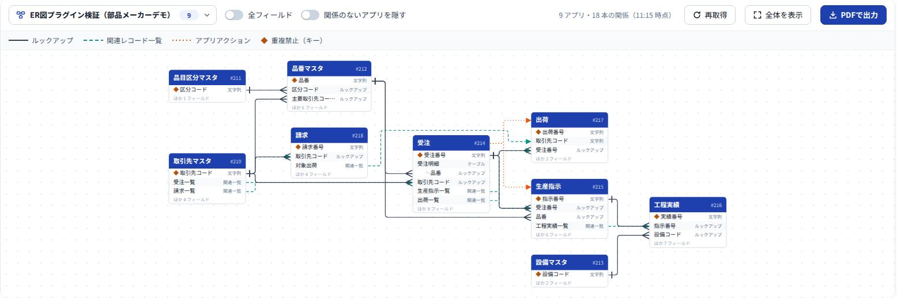
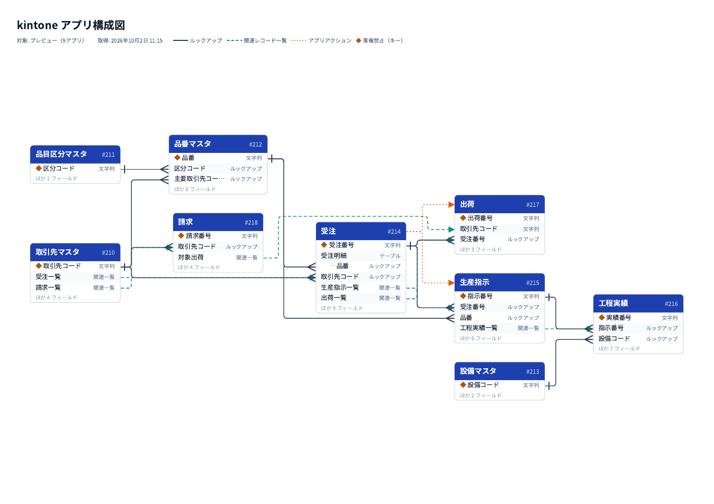
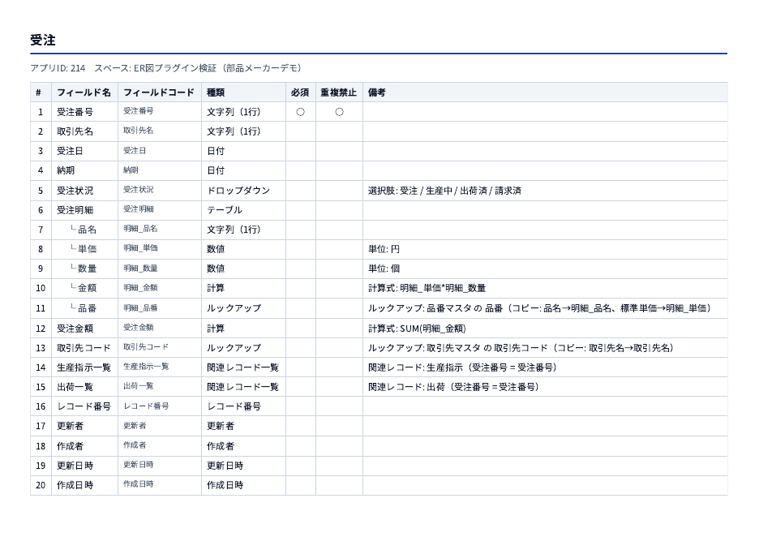

# Tsumugi for kintone

**kintone の全アプリの構成図（ER図）とアプリ定義書を、kintone の中で描いて PDF に出力するプラグイン**です。
「前任者が作ったアプリのつながりが分からない」「引き継ぎ用の設計書がない」を、ボタン1つで解消します。



- 閲覧できる全アプリを自動で読み込み、アプリ間の関係を3種類とも線で描きます
  - **ルックアップ**（実線・1対多の記号。テーブル内のルックアップも含む）
  - **関連レコード一覧**（破線）
  - **アプリアクション**（点線）
- スペースでの絞り込み、関係・キーのフィールドだけの要約表示と全フィールド表示の切り替え、拡大縮小・移動
- **PDFで出力**: 1ページ目にER図（A3横）、続けてアプリ一覧・関係一覧・アプリごとの定義書（A4横）を1冊にまとめます
- **外部への送信はありません。** ログイン中のユーザーの権限で、kintone REST API から構成を読むだけです

| PDF: ER図（A3横） | PDF: アプリ定義書（A4横） |
|---|---|
|  |  |

> 画面と PDF の例は、架空の部品メーカーの業務アプリ（`demo/`）で作っています。

## 導入

1. [Releases](../../releases) から `tsumugi-vX.Y.Z.zip` をダウンロードする
2. kintone システム管理 → **プラグイン** → 読み込む
3. 図を表示するためのアプリを1つ作り（空のアプリでよい）、そのアプリの設定 → **プラグイン** で Tsumugi を追加する
4. 同じアプリの **一覧** に「カスタマイズ」の一覧を作り、HTML に次の1行を入れてアプリを更新する

   ```html
   <div id="tsumugi"></div>
   ```

5. その一覧を開くと図が出ます。表示用のアプリ自身は図に含みません

### 見える範囲と権限

- 図に出るのは、**開いた人が閲覧できるアプリだけ**です。全体を出すときはシステム管理者で開いてください
- アプリアクションの読み込みには、そのアプリの**アプリ管理権限**が必要です
- 権限で読めなかった情報は、画面と PDF に「取得できなかった情報」として件数と内容を出します

### 知っておいてほしいこと

- **API の呼び出し回数**: 読み込むたびに「アプリ数 × 3回」（フィールド・レイアウト・アクション）の REST API を呼びます。目安は約10アプリ／秒です。読み込んだ結果はそのタブの中で10分間覚えておき、ツールバーの「再取得」で読み直せます
- **ゲストスペースのアプリは対象外**です（v0.1）
- PDF は新しいウィンドウで印刷画面を開きます。ポップアップがブロックされたら、kintone のドメインで許可してください

## 開発

```bash
npm install
cp .env.example .env    # 検証用の kintone 環境（cybozu developer network の開発者ライセンス推奨）
npm test                # 型チェックは npm run typecheck
npm run build           # dist/plugin を組み立てる
npm run upload          # 署名（private.ppk）してパッケージし、検証環境へ読み込む
```

| 場所 | 中身 |
|---|---|
| `src/core/` | 構成の読み込みとモデル化（`kintone.api` と Node の fetch のどちらでも動く） |
| `src/view/` | 図の組み立て・配置（elkjs）・SVG・印刷用の定義書・画面 |
| `demo/` | デモ用の架空の部品メーカーの業務アプリ（9アプリ）を作るスクリプト |
| `scripts/` | ビルド・読み込み・構成の書き出し（`npm run dump`）・PDF のプレビュー |

不具合の報告や改善の提案は [CONTRIBUTING.md](CONTRIBUTING.md) をご覧ください。

## ライセンス

[MIT](LICENSE)（Ｓｐｅｌｌ Ｔｈｅ Ｓｐａｃｅ合同会社）。配置計算に同梱している [elkjs](https://github.com/kieler/elkjs) は EPL-2.0 です（[THIRD_PARTY_LICENSES.txt](THIRD_PARTY_LICENSES.txt)）。

kintone はサイボウズ株式会社の登録商標です。本プラグインはサイボウズ株式会社の公式製品ではありません。

---

## English

**Tsumugi for kintone** is a kintone plugin that draws an ER diagram of all the apps you can view — lookups (including those inside tables), related records and app actions — and prints it, together with a field-definition sheet for every app, as a single PDF. Nothing is sent outside kintone; it only reads app settings through the REST API with the signed-in user's permissions.

Install: download the zip from Releases, import it in kintone's plugin settings, add it to an (empty) app, and create a custom view whose HTML is `<div id="tsumugi"></div>`. Guest spaces are not supported yet. Licensed under MIT; bundles elkjs (EPL-2.0). kintone is a registered trademark of Cybozu, Inc.; this plugin is not an official Cybozu product.
